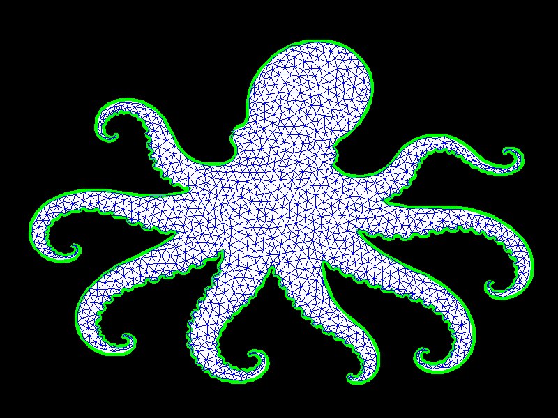
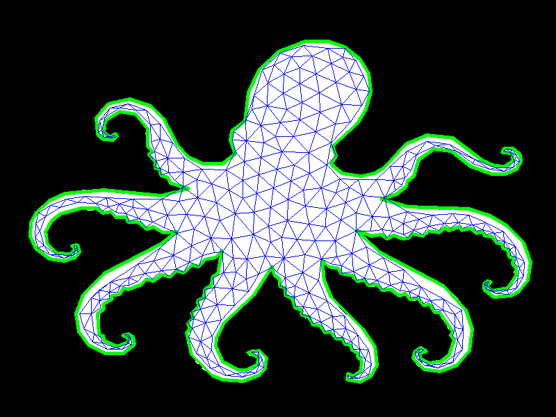

# Mesh Contraction Skeletonization

Extract a 1D skeleton from a binary shape mask by (1) triangulating the shape's boundary polygon into a 2D mesh, and (2) iteratively **contracting** that mesh with a Laplacian-based least-squares solve until it collapses toward the shape's medial axis.

The method follows the *Skeleton Extraction by Mesh Contraction* idea (Au et al., 2008), adapted to a 2D triangulated region.

---

## 1. Dependencies

```python
import cv2
import numpy as np
import triangle
from scipy.sparse import coo_matrix, diags, csr_matrix
import scipy.sparse.linalg as spla
```

| Library | Role |
|---|---|
| `opencv-python` | Image loading, thresholding, contour extraction, visualisation |
| `numpy` | Dense array math |
| `triangle` | Constrained Delaunay triangulation (Shewchuk's *Triangle*) |
| `scipy.sparse` | Sparse Laplacian and linear solve |

---

## 2. Pipeline Overview

```
binary image ─► outer contour ─► simplified polygon ─► triangulation (V, F)
                                                            │
                                         ┌──────────────────┘
                                         ▼
                      repeat:  build L ─► solve for V' ─► update W_L, W_H
                                         │
                                         ▼
                                   contracted mesh ≈ skeleton
```

---

## 3. Creating the Mesh


### 3.1 Preprocessing

1. Read `test3.png` and resize to **800 × 600**.
2. Convert to grayscale and binarize with threshold 127:

$$
I_{bin}(x,y)=\begin{cases}255 & I(x,y) > 127\\ 0 & \text{otherwise}\end{cases}
$$

### 3.2 Contour extraction

- `cv2.findContours(..., RETR_EXTERNAL, CHAIN_APPROX_SIMPLE)` returns only outer contours.
- The contour with the **largest area** is kept as the shape boundary.

### 3.3 Polygon simplification (Douglas–Peucker)

```python
approx = cv2.approxPolyDP(contour, epsilon=1, closed=True)
```


With tolerance $\varepsilon = 1$ px, a contour point is dropped if it lies within $\varepsilon$ of the line joining its neighbours.


```python
approx = cv2.approxPolyDP(contour, epsilon=3, closed=True)
```


With tolerance $\varepsilon = 3$ px, a contour point is dropped if it lies within $\varepsilon$ of the line joining its neighbours.

### 3.4 Planar Straight-Line Graph (PSLG)

For $n$ polygon vertices $p_0,\dots,p_{n-1}$, the boundary segments are

$$
s_i = (i,\ (i+1) \bmod n), \qquad i = 0,\dots,n-1 .
$$

### 3.5 Triangulation

```python
result = triangle.triangulate({'vertices': approx, 'segments': edge}, 'pq15a100')
```

| Switch | Meaning |
|---|---|
| `p` | Triangulate a PSLG (respect the given segments) |
| `q15` | Quality mesh: no angle smaller than 15° |
| `a100` | Maximum triangle area of 100 px² |





| Switch | Meaning |
|---|---|
| `p` | Triangulate a PSLG (respect the given segments) |
| `q15` | Quality mesh: no angle smaller than 15° |
| `a500` | Maximum triangle area of 100 px² |



**Outputs**

- $V \in \mathbb{R}^{N\times 2}$ — vertex coordinates (includes Steiner points inserted for quality)
- $F \in \mathbb{Z}^{M\times 3}$ — triangle vertex indices


---

## 4. Contraction Algorithm

### 4.1 Core idea

Find new vertex positions $V'$ that minimise a weighted sum of two competing energies:

$$
\boxed{\;
E(V') \;=\; \sum_i \big\| W_{L,i}\,(L V')_i \big\|^2 \;+\; \sum_i W_{H,i}^2 \,\big\| V'_i - V_i \big\|^2
\;}
$$

- **Contraction term** (weight $W_L$): drives each vertex to the average of its neighbours, shrinking the mesh.
- **Attraction term** (weight $W_H$): holds each vertex near its current position, preventing total collapse to a point.

Writing $W_L=\mathrm{diag}(W_{L,i})$ and $W_H=\mathrm{diag}(W_{H,i})$, this is the least-squares problem

$$
\begin{bmatrix} W_L L \\ W_H \end{bmatrix} V'
=
\begin{bmatrix} 0 \\ W_H V \end{bmatrix}.
$$

Setting the gradient of $E$ to zero gives the **normal equations** that the code actually solves (for each coordinate $x$ and $y$ independently):

$$
\boxed{\;
\big(L^{\top} W_L^{2} L + W_H^{2}\big)\, V' \;=\; W_H^{2}\, V
\;}
$$

`A = L.T @ W_L2 @ L + W_H2` is sparse, so it is solved with `scipy.sparse.linalg.spsolve`.

---

### 4.2 Laplacian matrix

#### Uniform Laplacian (used)

With $\mathcal{N}(i)$ the set of 1-ring neighbours of vertex $i$:

$$
L_{ij}=\begin{cases}
1 & j\in\mathcal{N}(i)\\[2pt]
-\lvert\mathcal{N}(i)\rvert & j=i\\[2pt]
0 & \text{otherwise}
\end{cases}
$$

so that

$$
(LV)_i = \sum_{j\in\mathcal{N}(i)} (V_j - V_i).
$$

Implementation notes:

- Every triangle $(i,j,k)$ contributes the six directed entries $(i,j),(j,i),(j,k),(k,j),(k,i),(i,k)$.
- An edge shared by two triangles is summed twice by the sparse constructor, so `L_off.data[:] = 1.0` resets all off-diagonal values to a pure 0/1 adjacency.
- The diagonal is the negative row sum, so every row sums to zero.

```python
def build_L(V, F):
    N = len(V)
    i, j, k = F[:, 0], F[:, 1], F[:, 2]

    rows = np.concatenate([i, j, j, k, k, i])
    cols = np.concatenate([j, i, k, j, i, k])
    data = np.ones(len(rows), dtype=float)

    L_off = csr_matrix((data, (rows, cols)), shape=(N, N))
    L_off.data[:] = 1.0  # Adjacency

    row_sums = np.array(L_off.sum(axis=1)).flatten()
    L_diag = csr_matrix((-row_sums, (np.arange(N), np.arange(N))), shape=(N, N))
    return L_off + L_diag
```

> The uniform Laplacian gave better results in practice than the cotangent version below.

#### Cotangent Laplacian (alternative, commented out)

For a triangle with vertices $v_i, v_j, v_k$, the cotangent of the angle at $v_k$ (opposite edge $ij$) is computed from $u = v_i - v_k$, $w = v_j - v_k$:

$$
\cot\theta_k = \frac{u\cdot w}{\lvert u_x w_y - u_y w_x\rvert}
$$

The denominator is clamped to $\ge 10^{-10}$ and the result is clipped to $[-10, 10]$.

Each triangle contributes a half-cotangent weight to the edge opposite each angle:

$$
w_{ij}\mathrel{+}=\tfrac12\cot\theta_k,\qquad
w_{jk}\mathrel{+}=\tfrac12\cot\theta_i,\qquad
w_{ki}\mathrel{+}=\tfrac12\cot\theta_j .
$$

Summed over the (up to two) triangles sharing an edge, this gives the classic

$$
L_{ij}=w_{ij}=\tfrac12\big(\cot\alpha_{ij}+\cot\beta_{ij}\big),\qquad
L_{ii}=-\sum_{j\in\mathcal{N}(i)} w_{ij}.
$$

```python
# def build_L(V, F):
#     N = len(V)
#     i, j, k = F[:, 0], F[:, 1], F[:, 2]
#     vi, vj, vk = V[i], V[j], V[k]
#     def cot_vec(a, b, c):
#         u, v = a - c, b - c
#         cosang = np.sum(u * v, axis=1)
#         sinang = np.abs(u[:, 0] * v[:, 1] - u[:, 1] * v[:, 0])
#         sinang = np.maximum(sinang, 1e-10)
#         return np.clip(cosang / sinang, -10.0, 10.0)
#     wk = cot_vec(vi, vj, vk) / 2.0
#     wi = cot_vec(vj, vk, vi) / 2.0
#     wj = cot_vec(vk, vi, vj) / 2.0
#     rows = np.concatenate([i, j, j, k, k, i])
#     cols = np.concatenate([j, i, k, j, i, k])
#     data = np.concatenate([wk, wk, wi, wi, wj, wj])
#     L_off = csr_matrix((data, (rows, cols)), shape=(N, N))
#     row_sums = np.array(L_off.sum(axis=1)).flatten()
#     L_diag = csr_matrix((-row_sums, (np.arange(N), np.arange(N))), shape=(N, N))
#     return L_off + L_diag
```

---

### 4.3 Areas

#### Triangle area (shoelace formula)

For a triangle with vertices $p_0=(x_0,y_0)$, $p_1$, $p_2$:

$$
A_f=\tfrac12\Big|\,x_0(y_1-y_2)+x_1(y_2-y_0)+x_2(y_0-y_1)\Big|
$$

```python
def face_areas(V, F):
    i, j, k = F[:,0], F[:,1], F[:,2]
    p0, p1, p2 = V[i], V[j], V[k]
    return 0.5*np.abs(p0[:,0]*(p1[:,1]-p2[:,1]) + p1[:,0]*(p2[:,1]-p0[:,1]) + p2[:,0]*(p0[:,1]-p1[:,1]))
```

Total mesh area:

$$
A_{total}=\sum_{f\in F} A_f
$$

#### Per-vertex area $\Omega_i$

Each triangle distributes one third of its area to each of its three vertices. Degenerate triangles are floored at $10^{-6}$ to avoid division by zero later:

$$
\Omega_i=\sum_{f\ni i}\frac{\max(A_f,\,10^{-6})}{3}
$$

```python
def vertex_areas(V, F):
    N = len(V)
    i, j, k = F[:,0], F[:,1], F[:,2]
    p0, p1, p2 = V[i], V[j], V[k]
    area = 0.5*np.abs(p0[:,0]*(p1[:,1]-p2[:,1]) + p1[:,0]*(p2[:,1]-p0[:,1]) + p2[:,0]*(p0[:,1]-p1[:,1]))
    area_safe = np.maximum(np.abs(area), 1e-6)
    A = np.zeros(N)
    np.add.at(A, i, area_safe/3)
    np.add.at(A, j, area_safe/3)
    np.add.at(A, k, area_safe/3)
    return A
```

---

### 4.4 Smoothing the vertex areas

$\Omega$ is smoothed with a neighbour average, repeated for 2 iterations:

$$
\Omega_i \leftarrow \frac{\Omega_i + \sum_{j} m_{ij}\,\Omega_j}{1 + \sum_{j} m_{ij}}
$$

where $m_{ij}$ is the number of times the edge $(i,j)$ appears in the triangle edge list (1 on the boundary, 2 for interior edges). The function is optional and has little visible effect, so it may be removed.

```python
def smooth_omega(Omega, F, iterations=2):
    N = len(Omega)
    edges = np.vstack([F[:,[0,1]], F[:,[1,2]], F[:,[2,0]]])
    for _ in range(iterations):
        s = np.zeros(N); c = np.zeros(N)
        np.add.at(s, edges[:,0], Omega[edges[:,1]]); np.add.at(c, edges[:,0], 1)
        np.add.at(s, edges[:,1], Omega[edges[:,0]]); np.add.at(c, edges[:,1], 1)
        Omega = (Omega + s) / (1 + c)
    return Omega
```

---

### 4.5 The contraction step

```python
def contract(Wl, Wh, V_next, L, V_cur, Gamma=0.5):
    V_cur = (0.8*V_cur) + (0.20*V_next)
    W_L2 = diags(Wl**2)
    W_H2 = diags(Wh**2)
    A = L.T @ W_L2 @ L + W_H2
    B = W_H2 @ V_cur
    V_next = spla.spsolve(A.tocsr(), B)
    return V_next
```

Mathematically:

$$
\tilde V = 0.8\,V_{cur} + 0.2\,V_{next},
\qquad
V' = \big(L^{\top} W_L^2 L + W_H^2\big)^{-1} W_H^2\,\tilde V .
$$

Notes:

- The blend with `V_next` is a damping term. In the main loop both arguments are the previous iterate, so $\tilde V = V$ and the blend has no effect there.
- `Gamma` and the commented-out relaxation line `V = (1-Γ)·V_cur + Γ·V'` are unused.

.png)


---

### 4.6 Weight initialisation and update

#### Initial weights

$$
W_{L,i}^{(0)}=10^{-3}\sqrt{A_{total}},
\qquad
W_{H,i}^{(0)} = W_{H0,i}=1,
\qquad
\Omega^{(0)}=\max\!\big(\mathrm{smooth}(\Omega_{raw}),\ 0.1\,\overline{\Omega}\big)
$$

The floor $0.1\,\overline{\Omega}$ prevents tiny initial vertex areas from producing huge $W_H$ values later.

#### Per-iteration update

$$
\boxed{\;
W_L^{(t+1)} = s_L\, W_L^{(t)},
\qquad
W_{H,i}^{(t+1)} = W_{H0,i}\,\sqrt{\frac{\Omega^{(0)}_i}{\max(\Omega^{(t)}_i,\,10^{-8})}}
\;}
$$

with $s_L = 1.5$.

- **$W_L$ grows geometrically** ($W_L^{(t)} = 1.5^{\,t}\,W_L^{(0)}$; $1.5^{20}\approx 3325$), so contraction progressively dominates.
- **$W_H$ grows as local area shrinks**: when a vertex's area $\Omega_i^{(t)}$ falls, $W_{H,i}$ rises, anchoring regions that have already collapsed and keeping the system well-conditioned.

The balance between these two forces is what produces a smooth 1D skeleton.

```python
def update_weights(Wl, Wh, Wh0, Omega_0, Omega_t, s_L, Wl_cap=100, Wh_cap=50.0, max_growth=1.3):
    Wl_next = Wl * s_L
    Wh_next = Wh0 * np.sqrt(Omega_0 / np.maximum(Omega_t, 1e-8))
    return Wl_next, Wh_next
```

`Wl_cap`, `Wh_cap` and `max_growth` are currently unused (their clamping lines are commented out).

An earlier variant, `update_deformation_weights`, also blended the new $W_H$ with the old one using $\alpha = 0.4$ and capped growth at $1.3\times$. It is kept commented out for reference.

---

## 5. Diagnostic Utilities

These are not part of the algorithm itself; they were added to locate numerical problems and can be removed.

### 5.1 Collapsed edges

Over the set of unique undirected edges $\mathcal{E}$, with $\ell_e^{0}$ the original and $\ell_e$ the current length:

$$
r_e=\frac{\ell_e}{\max(\ell_e^{0},\,10^{-8})},
\qquad
\text{collapsed if } r_e < \tau_{shrink}=0.05 .
$$

```python
def find_collapsed_edges(V, F, V_original, shrink_threshold=0.05):
    edges = np.vstack([F[:, [0,1]], F[:, [1,2]], F[:, [2,0]]])
    edges = np.unique(np.sort(edges, axis=1), axis=0)

    orig_lens = np.linalg.norm(V_original[edges[:,0]] - V_original[edges[:,1]], axis=1)
    curr_lens = np.linalg.norm(V[edges[:,0]] - V[edges[:,1]], axis=1)

    shrink_ratio = curr_lens / np.maximum(orig_lens, 1e-8)
    collapsed_edges = edges[shrink_ratio < shrink_threshold]

    print(f"total edges: {len(edges)}")
    print(f"collapsed (shrunk to <{shrink_threshold*100:.0f}% of original): {len(collapsed_edges)}  ({100*len(collapsed_edges)/len(edges):.1f}%)")
    print(f"shrink ratio range: min={shrink_ratio.min():.4f} max={shrink_ratio.max():.4f} mean={shrink_ratio.mean():.4f}")

    return collapsed_edges, shrink_ratio, edges
```

### 5.2 Exploding edges

Same ratio $r_e$, flagged when it **grows** beyond $\tau_{grow}=3$:

$$
\text{exploding if } r_e > 3.0 .
$$

```python
def find_exploding_edges(V, F, V_original, grow_threshold=3.0):
    edges = np.vstack([F[:, [0,1]], F[:, [1,2]], F[:, [2,0]]])
    edges = np.unique(np.sort(edges, axis=1), axis=0)

    orig_lens = np.linalg.norm(V_original[edges[:,0]] - V_original[edges[:,1]], axis=1)
    curr_lens = np.linalg.norm(V[edges[:,0]] - V[edges[:,1]], axis=1)
    ratio = curr_lens / np.maximum(orig_lens, 1e-8)

    exploding_edges = edges[ratio > grow_threshold]
    exploding_verts = np.unique(exploding_edges)

    print(f"exploding edges (>{grow_threshold}x original): {len(exploding_edges)}")
    if len(exploding_verts) > 0:
        print("vertex positions involved (current, pixel space):")
        print(V[exploding_verts][:10])

    return exploding_edges, exploding_verts
```

### 5.3 Progress metric

$$
\text{area ratio}_t=\frac{\sum_f A_f\big(V^{(t)}\big)}{A_{total}}
$$

This should decrease towards 0 as the mesh collapses onto the skeleton.

---

## 6. Main Driver

### 6.1 Initialisation

```python
V  = np.array(result["vertices"],  dtype=float)
V1 = V.copy()                                   # current iterate
V2 = V.copy()                                   # previous iterate
F  = np.array(result["triangles"], dtype=int)
N  = len(V)

total_area_t = face_areas(V, F).sum()
Wl  = np.full(N, 1e-3*(np.sqrt(np.mean(total_area_t))))
Wh  = np.full(N, 1.0)
Wh0 = Wh.copy()

Omega_0_raw = vertex_areas(V, F)
Omega_0 = smooth_omega(Omega_0_raw, F, iterations=2)
Omega_0 = np.maximum(Omega_0, 0.1 * Omega_0.mean())

print("checking original mesh\n====")
find_collapsed_edges(V1, F, V)
```

### 6.2 Iteration loop (20 steps)

Each step:

1. Snapshot the background image for this frame.
2. Build $L$ from the current mesh: `L = build_L(V1, F)`.
3. Solve for new vertices: `V1 = contract(Wl, Wh, V1, L, V2)`.
4. Recompute and smooth vertex areas $\Omega^{(t)}$.
5. Update the weights with $s_L = 1.5$.
6. Compute the edge-length ratios, count exploding edges, and print a status line.
7. Draw the triangles of the contracted mesh and display the frame.
8. Set `V2 = V1` for the next iteration.

```python
image_frames = {}
i = 6
for step in range(20):
    image_frames[i] = image4.copy()
    L = build_L(V1, F)
    V1 = contract(Wl, Wh, V1, L, V2)
    Omega_t = smooth_omega(vertex_areas(V1, F), F, iterations=2)
    Wl, Wh = update_weights(Wl, Wh, Wh0, Omega_0, Omega_t, s_L=1.5, Wh_cap=50.0)
    disp = np.linalg.norm(V1 - V, axis=1)
    area_ratio = face_areas(V1, F).sum() / total_area_t
    V2 = V1

    edges = np.vstack([F[:, [0,1]], F[:, [1,2]], F[:, [2,0]]])
    edges = np.unique(np.sort(edges, axis=1), axis=0)
    orig_lens = np.linalg.norm(V[edges[:,0]]  - V[edges[:,1]],  axis=1)
    curr_lens = np.linalg.norm(V1[edges[:,0]] - V1[edges[:,1]], axis=1)
    ratio = curr_lens / np.maximum(orig_lens, 1e-8)
    n_exploding = np.sum(ratio > 3.0)

    area_ratio = face_areas(V1, F).sum() / total_area_t
    print(f"step={step:2d} area_ratio={area_ratio:.4e} exploding_edges={n_exploding} "
          f"Wl_max={Wl.max():.3g} Wh_max={Wh.max():.3g}")

    for x in result['triangles']:
        p = V1[x].astype(np.int32)
        cv2.polylines(image_frames[i], [p], True, (255, 0, 0), 1)
    cv2.imshow(f"mesh{i}", image_frames[i])
    cv2.waitKey(20000)
    i = i + 1
```

The per-step console output contains the area ratio, the number of exploding edges, and the maximum of each weight vector.

---

## 7. Equation Summary

| # | Quantity | Equation |
|---|---|---|
| 1 | Boundary segments | $s_i=(i,\,(i+1)\bmod n)$ |
| 2 | Uniform Laplacian | $(LV)_i=\sum_{j\in\mathcal N(i)}(V_j-V_i)$ |
| 3 | Cotangent weight | $w_{ij}=\tfrac12(\cot\alpha_{ij}+\cot\beta_{ij})$ |
| 4 | Triangle area | $A_f=\tfrac12\lvert x_0(y_1-y_2)+x_1(y_2-y_0)+x_2(y_0-y_1)\rvert$ |
| 5 | Vertex area | $\Omega_i=\sum_{f\ni i}A_f/3$ |
| 6 | Area smoothing | $\Omega_i\leftarrow(\Omega_i+\sum_j m_{ij}\Omega_j)/(1+\sum_j m_{ij})$ |
| 7 | Energy | $E=\sum_i\lVert W_{L,i}(LV')_i\rVert^2+\sum_i W_{H,i}^2\lVert V_i'-V_i\rVert^2$ |
| 8 | Linear system | $(L^\top W_L^2L+W_H^2)V'=W_H^2V$ |
| 9 | Contraction weight | $W_L^{(t+1)}=s_L\,W_L^{(t)}$ |
| 10 | Attraction weight | $W_{H,i}^{(t+1)}=W_{H0,i}\sqrt{\Omega_i^{(0)}/\Omega_i^{(t)}}$ |
| 11 | Initial $W_L$ | $W_L^{(0)}=10^{-3}\sqrt{A_{total}}$ |
| 12 | Edge ratio | $r_e=\ell_e/\ell_e^{0}$ (collapsed $<0.05$, exploding $>3$) |
| 13 | Area ratio | $\sum_fA_f(V^{(t)})/A_{total}$ |

---

## 8. Parameters

| Parameter | Value | Where | Effect |
|---|---|---|---|
| Resize | 800 × 600 | preprocessing | Working resolution |
| Binary threshold | 127 | preprocessing | Mask extraction |
| `approxPolyDP` ε | 1 px | polygon simplification | Boundary detail |
| Triangle switches | `pq15a100` | triangulation | Min angle 15°, max area 100 px² |
| $W_L^{(0)}$ | $10^{-3}\sqrt{A_{total}}$ | init | Initial contraction strength |
| $W_H^{(0)}$ | 1.0 | init | Initial attraction strength |
| $s_L$ | 1.5 | weight update | Growth rate of contraction |
| Smoothing iterations | 2 | `smooth_omega` | Smoothness of $\Omega$ |
| $\Omega^{(0)}$ floor | $0.1\,\overline\Omega$ | init | Bounds $W_H$ growth |
| Iterations | 20 | main loop | Number of contraction steps |
| Collapse threshold | 0.05 | diagnostics | Debug only |
| Explode threshold | 3.0 | diagnostics | Debug only |

---

## 9. Implementation Notes

- **Unused parameters:** `Gamma`, `Wl_cap`, `Wh_cap` and `max_growth` have no effect in the current code.
- **Blend in `contract`:** because `V1` and `V2` are equal at every call, the $0.8/0.2$ blend leaves the vertices unchanged.
- **Display:** `cv2.waitKey(20000)` waits up to 20 s per frame; press any key to advance. Use `cv2.imwrite` (commented) to save frames instead.
- **Exploding edges:** a rising count signals numerical instability; consider re-enabling the $W_H$ clamping and growth limiting lines in `update_weights`.
- **Result:** the final `V1` holds the contracted vertices; together with `F` they form a mesh that has collapsed approximately onto the 1D skeleton.